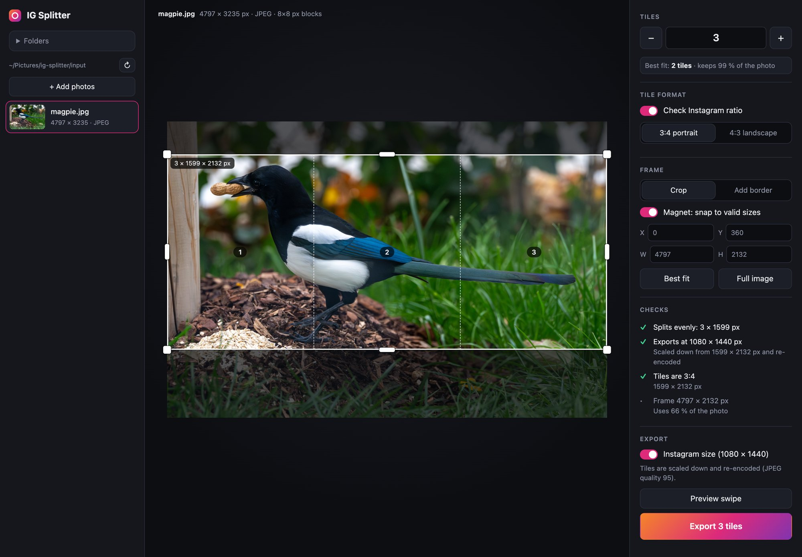
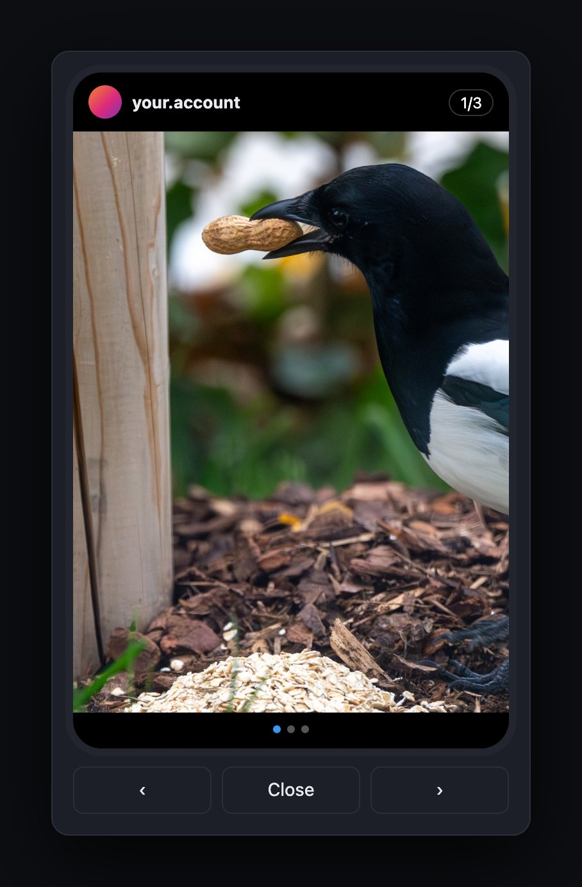

# IG Splitter

**Turn a wide photo or panorama into a seamless Instagram carousel, in your browser, on your own machine.**

An Instagram post can hold up to 20 photos that people swipe through like a slideshow (a
"carousel"). Cut a panorama into equal tiles, post them in order, and the swipe feels like one
continuous picture. Doing that by hand is fiddly. Every tile needs exactly the same width and
Instagram's 3:4 or 4:3 shape, the cuts must line up to the pixel, and most editors re-compress
the photo along the way. IG Splitter handles all of it. Drop a photo in, choose how many tiles,
drag the frame, check the swipe in a phone preview, and download the tiles.

It runs as a small local web app, started with plain Python or self-hosted with Docker (on a
NAS, a home server, …). Nothing is uploaded anywhere else.



> [!NOTE]
> **This project is vibecoded.** It was built mostly by prompting an AI coding assistant, with a
> human steering, testing and reviewing. It has a test suite and works well for its author, but
> read the code before you rely on it, and expect rough edges. Issues and PRs are welcome.

## Features

- **2–20 equal tiles**, checked against Instagram's **3:4** (portrait) or **4:3** (landscape)
  format.
- **Drag the frame** or type X / Y / W / H. A **magnet** snaps the frame to valid sizes, and
  **Best fit** suggests the tile count that keeps the most of your photo.
- **Crop** the photo to the grid, or **add a border** (white, black or any colour) to keep the
  whole photo.
- **Swipe preview** in a phone mock-up, to check the seams before you post.
- **Export at Instagram size** (exactly 1080 × 1440 or 1440 × 1080), or **losslessly** with no
  re-encoding at all (see [Export modes](#export-modes)).
- **Drag & drop upload**, plus download links per tile or for all tiles as one zip. This works
  from a phone too.
- **Optional password login** for when it runs on your network.
- **One Python dependency** (Pillow). No accounts, no cloud, no tracking.

## Contents

- [Quick start: plain Python](#quick-start-plain-python)
- [Quick start: Docker](#quick-start-docker)
- [Login](#login)
- [Configuration](#configuration)
- [How to use it](#how-to-use-it)
- [Export modes](#export-modes)
- [Security notes](#security-notes)
- [Troubleshooting](#troubleshooting)
- [Development](#development)

## Quick start: plain Python

Use this to run it on your own computer. It works on macOS and Linux; on Windows, use Docker
(or WSL).

**1. Requirements:** Python 3.10 or newer. Optionally, two command-line tools for the lossless
export mode:

| Tool | Needed for | macOS | Debian / Ubuntu |
|---|---|---|---|
| `jpegtran` (libjpeg-turbo) | lossless JPEG tiles | `brew install jpeg-turbo` | `sudo apt install libjpeg-turbo-progs` |
| ImageMagick | lossless 16-bit PNG tiles | `brew install imagemagick` | `sudo apt install imagemagick` |

The default export (Instagram size) only needs Python and Pillow.

**2. Get the code and install Pillow:**

```bash
git clone https://github.com/Cloudy261/ig-splitter.git
cd ig-splitter
python3 -m venv .venv
source .venv/bin/activate
pip install -r requirements.txt
```

**3. Start it:**

```bash
python3 app.py
```

Your browser opens http://localhost:8765. No login is needed, because the app only listens on
`localhost`. Stop it with `Ctrl+C`.

Useful flags:

| Flag | Meaning |
|---|---|
| `--port 9000` | use another port (default `8765`) |
| `--no-browser` | don't open the browser |
| `--host 0.0.0.0` | listen on the network as well (see below) |
| `--no-login` | never ask for a password, also on the network |
| `--hash-password` | create a password hash for the login and exit |

Photos and tiles go into these folders, which are created on first start. You can change them
in the app under **Folders**.

- Input: `~/Pictures/ig-splitter/input`
- Output: `~/Pictures/ig-splitter/output/<photo name>/<name>_1of3.jpg`, …

### Reaching the Python version from other devices

To open the app from your phone or another computer, make it listen on the network. You also
have to decide about the login. With a password:

```bash
python3 app.py --hash-password            # asks for a password, prints pbkdf2-sha256:…
export IG_SPLITTER_PASSWORD_HASH='pbkdf2-sha256:…'   # the line it printed
export IG_SPLITTER_HOSTS=192.168.1.20     # your computer's IP or host name
python3 app.py --host 0.0.0.0 --no-browser
```

Or, on a network you trust, without a password:

```bash
export IG_SPLITTER_HOSTS=192.168.1.20
python3 app.py --host 0.0.0.0 --no-browser --no-login
```

Then open `http://192.168.1.20:8765` on the other device.

## Quick start: Docker

Use this to self-host it on a server, NAS or Raspberry Pi so every device on your network can
use it. You need Docker with the Compose plugin.

**1. Get the code and create your settings file:**

```bash
git clone https://github.com/Cloudy261/ig-splitter.git
cd ig-splitter
cp .env.example .env
```

**2. Create the data folders.** The container runs as UID 1000, so it must be able to write
there:

```bash
mkdir -p data/input data/output
sudo chown -R 1000:1000 data    # Linux only, and only if your own user isn't UID 1000 (check with: id -u)
```

**3. Create a password hash** (skip this if you want no login, see step 4):

```bash
docker compose build
docker compose run --rm ig-splitter python app.py --hash-password
```

It asks for a password twice (12+ characters) and prints a line like
`pbkdf2-sha256:1000000:…:…`. Only that hash is stored, never the password itself.

**4. Edit `.env`:**

```ini
# the IP / host name(s) you'll open the app with
IG_SPLITTER_HOSTS=192.168.1.20,myserver.local
# paste the line from step 3
IG_SPLITTER_PASSWORD_HASH=pbkdf2-sha256:1000000:…:…
```

If you don't want a login (trusted network, or a reverse proxy that does authentication), set
`IG_SPLITTER_LOGIN=off` instead and leave the hash empty.

**5. Start it:**

```bash
docker compose up -d --build
```

```bash
docker compose ps                  # after ~1 minute: "Up … (healthy)"
docker compose logs ig-splitter    # shows "Login: required" (or "off")
```

Open `http://<server-ip>:8765`. It restarts with Docker after a reboot
(`restart: unless-stopped`).

**Updating:** `git pull`, then run `docker compose up -d --build` again.

In Docker, the input and output folders are fixed to `./data/input` and `./data/output`.
Photos come in through **+ Add photos** or drag & drop, tiles go out through the download
links, and the **Folders** panel is read-only.

The container is hardened: it runs as a non-root user with no Linux capabilities, a read-only
root file system, and memory, CPU and process limits.

## Login

The login is a single password. It's **on by default** and is required as soon as the app
listens on the network.

| Setup | Result |
|---|---|
| `python3 app.py` (localhost only), no hash | no login |
| any setup with `IG_SPLITTER_PASSWORD_HASH` set | login required |
| listening on the network (Docker, `--host 0.0.0.0`), no hash | **refuses to start** and tells you what to do |
| `IG_SPLITTER_LOGIN=off` or `--no-login` | no login, even with a hash set; prints a warning on the network |

How it works:

- **Hash:** PBKDF2-SHA256 with 1,000,000 iterations and a random salt. Only the hash is stored.
- **Lockout:** 5 wrong passwords from one IP lock that IP out for 15 minutes.
- **Sessions:** last 30 days, in an `HttpOnly`, `SameSite=Strict` cookie. They're kept in
  memory, so a restart logs everyone out.

**Change the password:** create a new hash, put it into `.env` (or the environment variable),
and restart (`docker compose up -d`). This also ends all sessions.

**Locked out?** Wait 15 minutes, or restart the app (`docker compose restart`), which clears
lockouts and sessions.

## Configuration

Everything is set with environment variables (in Docker: in `.env`).

| Variable | Default | Meaning |
|---|---|---|
| `IG_SPLITTER_LOGIN` | `on` | `on` or `off`. `off` turns the login off completely. Same as `--no-login`. |
| `IG_SPLITTER_PASSWORD_HASH` | empty | Login password hash from `--hash-password`. |
| `IG_SPLITTER_HOSTS` | empty | Extra host names / IPs the UI may be opened with, comma-separated. `localhost` and `127.0.0.1` always work. |
| `IG_SPLITTER_INPUT`, `IG_SPLITTER_OUTPUT` | `~/Pictures/ig-splitter/…` (Docker: `/data/…`) | Fix the folders. The UI can't change them then. |
| `IG_SPLITTER_BIND` *(Docker only)* | `0.0.0.0` | Host address the port is published on. Set it to one IP to listen on that interface only. |
| `IG_SPLITTER_PORT` *(Docker only)* | `8765` | Host port. |
| `IG_SPLITTER_DATA` *(Docker only)* | `./data` | Folder on the host holding `input/` and `output/`. |

**Why `IG_SPLITTER_HOSTS`?** The app only answers requests addressed to a host name it knows.
This blocks [DNS rebinding](https://en.wikipedia.org/wiki/DNS_rebinding), where a malicious
website tricks your browser into talking to apps on your network. If you see
`Forbidden: unknown host name`, add the name or IP from your browser's address bar.

When the app runs locally, the folders you pick under **Folders** are saved in `config.json` in
the app folder.

## How to use it

1. **Add photos.** Drag JPEG or PNG files onto the window, use **+ Add photos**, or put them
   into the input folder. Then pick one on the left.
2. **Set the number of tiles.** **Best fit** suggests the count that keeps the most of the
   photo, preferring tiles at least 1080 px wide.
3. **Tile format:** choose **3:4 portrait** or **4:3 landscape**. With the ratio check on (the
   default), every tile must match it.
4. **Frame:**
   - **Crop** cuts the photo to the tile grid.
   - **Add border** keeps the whole photo and fills the rest with a border colour.
   - Drag the frame or its handles, or type X / Y / W / H. With the **Magnet** on, the frame
     only snaps to valid sizes.
5. If the frame doesn't fit, a banner at the bottom offers the nearest valid size.
6. **Preview swipe** shows the tiles in a phone mock-up. Swipe through to check the seams.

   

7. **Export.** Each tile gets a download link, and you can also download all of them as a
   zip. Post the tiles in order (`_1of3`, `_2of3`, …) as one Instagram carousel.

Your last settings (tile count, ratio, magnet, border, export mode) are remembered per
browser. On a Mac running the app locally, **Browse…** and **Show in Finder** open Finder.

## Export modes

- **Instagram size (default):** tiles become exactly **1080 × 1440** (3:4) or
  **1440 × 1080** (4:3). They are scaled down and re-encoded (JPEG at quality 95, or PNG),
  with the EXIF rotation applied and the colour profile (ICC) kept. Tiles smaller than that keep
  their size, and the app warns you, because Instagram would upscale them.
- **Lossless (switch "Instagram size" off):** nothing is re-encoded. JPEG in gives JPEG out,
  and PNG in gives PNG out.
  - **JPEG:** `jpegtran -crop` copies the compressed 8×8 blocks as they are, so the tiles hold
    exactly the original data. This only works when the cut lines sit on the JPEG block grid
    (8 or 16 px), so in this mode the magnet moves in those steps. Borders are encoded with the
    photo's own quantisation tables, and the photo's blocks are dropped in unchanged.
  - **PNG:** tiles keep the bit depth, palette and transparency, and all metadata (ICC, gamma,
    text, EXIF) is copied. 16-bit PNGs go through ImageMagick, because Pillow would reduce them
    to 8 bit.
  - **Rotated photos** keep their EXIF orientation tag.

Not carried over in either mode: HDR gain maps (Ultra HDR / iPhone HDR JPEGs).

## Security notes

- **Plain HTTP.** The app has no HTTPS of its own, so on your network the password and session
  cookie travel unencrypted. The login keeps out scanners and casual access, but not an attacker
  who is actively intercepting traffic on the same network.
- **Don't expose it to the internet directly.** If you want to reach it from outside, use a VPN,
  or a reverse proxy with HTTPS (Caddy, Traefik, nginx, …). Add the public host name to
  `IG_SPLITTER_HOSTS`. Behind a proxy, every visitor shares the proxy's IP, and so they also
  share the 5-attempt lockout.
- **Cross-site protection.** Besides the host-name check, the API only accepts JSON or raw
  binary uploads. Browsers can't send those from other websites without a CORS preflight, and
  the app never grants one.
- **Old exports pile up** in the output folder. Delete them now and then.

## Troubleshooting

| Symptom | Cause / fix |
|---|---|
| `Forbidden: unknown host name` | Add the host name or IP you opened it with to `IG_SPLITTER_HOSTS`, then restart. |
| `Refusing to listen on 0.0.0.0 without a login` | Set `IG_SPLITTER_PASSWORD_HASH`, or turn the login off with `IG_SPLITTER_LOGIN=off` / `--no-login`. In Docker, the container keeps restarting until you do; check `docker compose logs`. |
| `Not a valid password hash` | The hash was cut off or has extra quotes. Paste the full `pbkdf2-sha256:…` line again. |
| `` `jpegtran` not found `` | Install libjpeg-turbo (see the table above), or keep the Instagram-size export on. |
| Export fails with `Permission denied` (Docker) | The data folders aren't writable by UID 1000. Run `sudo chown -R 1000:1000 data`. |
| A huge 16-bit PNG fails with `cache resources exhausted` | Raise `mem_limit` and the `/tmp` size in `docker-compose.yml`. Outside Docker, your ImageMagick `policy.xml` limits may be too low. |
| "Too many attempts" | Wait 15 minutes, or restart the app. |
| Other devices can't connect | Check the server's firewall for port 8765, and that the app listens on the network (`--host 0.0.0.0`, or Docker). |

## Development

```bash
python3 -m unittest discover tests
```

The tests decode the tiles and compare them pixel by pixel with the source: JPEG with 4:4:4,
4:2:2 and 4:2:0 subsampling in all EXIF orientations, with and without borders, and PNG with
palette, RGBA and 16 bit. They also cover Instagram-size scaling, metadata, upload and
download, the login, and the cross-site guards. The lossless tests need `jpegtran` and
ImageMagick installed.

| File | What it does |
|---|---|
| `app.py` | HTTP server (Python standard library), JSON API, CLI |
| `splitter.py` | image logic: info, preview, cutting and export |
| `auth.py` | optional password login |
| `static/` | browser UI (plain HTML, CSS and JS, no build step) |
| `tests/` | unit and API tests |

## License

[MIT](LICENSE).

IG Splitter is not affiliated with, endorsed by or connected to Instagram or Meta.
